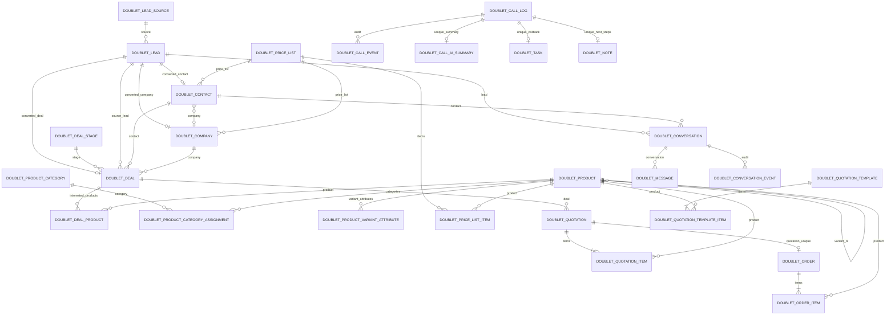

# Data Model & Entity Relationships

[← Documentation Index](../INDEX.md) · [Data Ownership](DATA_OWNERSHIP.md) · [Permission Model](PERMISSION_MODEL.md)

## 6.1 ERD hiện trạng

## 6.2 Dynamic Link và Frappe records

`DoubleT Task.reference_docname`, `DoubleT Appointment.reference_docname`, `DoubleT Note.reference_name` và `DoubleT Call Log.reference_name` là Dynamic Link. Controller giới hạn Task/Appointment/Note vào bốn entity Lead/Deal/Contact/Company. Call Log dùng `reference_doctype` Link DocType nhưng `DoubleTCallLog.validate_reference` chỉ cho `DoubleT Lead` hoặc `DoubleT Contact`; phone auto-match cũng chỉ quét hai DocType này. Call Log chưa có field riêng cho customer type, participant Contact, Company hoặc Deal context. `Communication`, `File`, `Comment`, `Version` và `Notification Log` là Frappe DocType dùng dynamic reference/attachment, không phải child table của business record.

## 6.3 Unique và snapshot

- `Product.sku`, `Product.variant_key`, `Deal Stage.stage_name`, `Lead Source.source_name`, `Price List.price_list_name`, `Quotation Template.template_name` unique.
- `Order.quotation` unique; `Call AI Summary.call_log`, `Task.callback_call_log`, `Note.source_call_log` unique.
- `Call Log.external_call_id` unique.
- `DoubleT Conversation.name` là deterministic key của `source + oa_id + external_user_id`; identity không được đổi sau tạo.
- `DoubleT Message.name` là deterministic key của `source + oa_id + external_message_id`; Message phải cùng source/OA với Conversation.
- `DoubleT Conversation Event` lưu action/actor/time, assignee/customer trước-sau, reason và hidden `request_id/request_hash`. Event có `request_id` dùng deterministic key `conversation + request_id` để chống replay khác payload; Event hệ thống như reopen vẫn là audit record nhưng không thay integration execution log đa kênh.
- Quotation/Order item lưu `product_name`, `sku`, price, quantity, discount và computed total như snapshot; Product/Price List thay đổi không được reprice lịch sử đã lưu.
- Contact hiện chỉ có một `company`; quan hệ nhiều Company là target `EXT-01`, không có trong ERD hiện trạng.

## 6.4 Provenance và projection xuyên hồ sơ

- Conversation giữ link trực tiếp tới Lead hoặc Contact. Sau Lead conversion, `zalo_inbox` truy converted Contact/Company/Deal từ Lead; Message không được sao chép sang customer record.
- Task/Note/Appointment/Call/Communication gắn exact source record. Một Contact có hai Deal không làm activity của Deal A trở thành activity của Deal B.
- Customer 360 là projection mục tiêu trên các source trên; mỗi row phải giữ source DocType/name, scope và trạng thái permission/unknown. Contract chi tiết: [Business Flow Contract](BUSINESS_FLOW_CONTRACT.md#customer-history-continuity).
