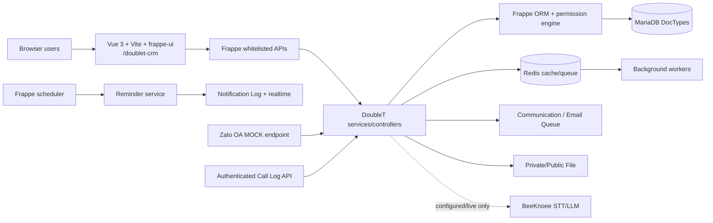
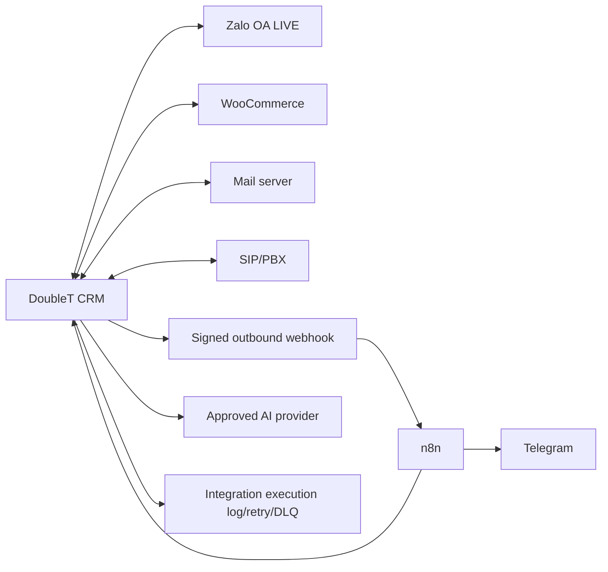

# Kiến trúc hệ thống

[← Documentation Index](../INDEX.md) · [Tổng quan](SYSTEM_OVERVIEW.md) · [Data Model](DATA_MODEL.md)

## 3.1 Kiến trúc hiện trạng

Backend là Frappe app `doublet_crm`; frontend dùng `createWebHistory('/doublet-crm')`. Business DocType/controller nằm trong app, không override Frappe core. `hooks.py` đăng ký permission hooks, document events, `after_migrate` setup và cron reminder mỗi phút. Background queue được dùng cho AI Call Summary và email delivery.

Frappe socket được khởi tạo ở frontend và Calls/Notification có realtime events, nhưng Zalo Inbox **không** publish/subscribe realtime ở baseline. MOCK inbound chỉ persistence; Inbox cần refresh. Kiến trúc target dùng event tối thiểu sau commit để client refetch qua permission-scoped API, kèm reconnect/poll fallback; xem [BF-RT-01](BUSINESS_FLOW_CONTRACT.md#bf-rt-01--inbound-chat--inboxthread-realtime).

## 3.2 Kiến trúc mục tiêu

Các đường nét mục tiêu cần authentication, signature verification, durable idempotency key, retry/log, protected secrets và acceptance trên provider thật. Baseline chưa có platform chung thỏa toàn bộ contract này.

## 3.3 Deployment topology

Môi trường được ghi nhận: Windows/VS Code → WSL checkout → Docker container `crm-frappe-1` → bench `/home/frappe/frappe-bench` → site `doublet.localhost`. MariaDB và Redis chạy container riêng. Build Vite phải phát hành đồng bộ `doublet_crm/public/frontend/` với `doublet_crm/www/doublet_crm.html`; đây là hướng dẫn, không phải bằng chứng build của baseline.

## API và Integration Contracts

## 12.1 Internal application APIs

| Module | Python method | Caller/Input | Output | Permission/validation/error/idempotency | Source |
| --- | --- | --- | --- | --- | --- |
| CRM | `doublet_lead.convert_lead` | Lead action; Lead/customer/deal args | converted links | Lead read/write/create linked records; duplicate conversion guarded | `.../doublet_lead.py` |
| CRM | `api.update_deal_stage` | Deal Kanban; deal, stage, lost_reason | updated Deal | Deal write; Stage exists; LOST reason | `doublet_crm/api.py` |
| Activity | `api.get_activities` | record tabs; doctype/name | versions/calls/notes/tasks/attachments | allowed reference + record read; filters unreadable children | `doublet_crm/api.py` |
| Task/Note | `get_linked_tasks`, `get_linked_notes`, `get_notes`, Frappe CRUD | record tabs/standalone pages | compatibility response / rows | exact reference + source read; Task/Note create/write | `api.py`, controllers |
| Activity | `list_appointments`, Frappe CRUD | Appointments; filters/document | rows/defaults/document | Appointment hooks, time/reference validation | `doublet_appointment.py` |
| Pricing | `pricing.get_product_price` | Quote/Order/Deal form | price/list/source | Product/customer/list read, sellability; zero preserved | `doublet_crm/pricing.py` |
| Sales | `sales_completion.get/save_deal_products` | Deal Products tab | safe snapshots | Deal read/write, modified concurrency, Product access | `sales_completion.py` |
| Sales | `get_quotation_draft_context` | Lead/Deal Create Quote | draft context only | Quotation create + exact Lead/Deal/customer links; no insert | `sales_completion.py` |
| Quotation | `list_quotations`, `get_site_today` | list/form | permission-scoped rows/date | read, filter validation | `doublet_quotation.py` |
| Quotation | approval APIs | form; name/version/reason/settings | updated approval/settings | manager-only approve/config; self-approval denied; snapshot/version | `doublet_quotation.py` |
| Quotation | PDF/email APIs | form/tabs; name/recipient/body/thread | PDF, context, Communication/queue | read/write/send guard; reply isolation; duplicate job protection | `quotation_pdf.py`, `quotation_email.py` |
| Order | `create_order_from_quotation` | Accepted Quote action | existing/new Order ID | Accepted, exact snapshot, Order create; row lock + unique link | `doublet_order.py` |
| Reports | five `reports.get_*` | report pages; dates/filters | aggregate + rows + availability | source read/field permission; validated dates | `doublet_crm/reports.py` |
| Insights | `get_smart_insights`, `create_follow_up_task` | report/dashboard | alerts/Task | source+Task permissions; revalidate alert; Redis lock/marker | `smart_insights.py` |
| Export | `export_report`, saved-filter APIs | ReportActions | BOM CSV/preferences | allowlist, rerun authorized query, formula neutralization, per-user settings | `report_tools.py` |

## 12.2 Contact Center and integration APIs

| Loại | Method/endpoint | Contract và trạng thái |
| --- | --- | --- |
| Inbound MOCK | `zalo_oa.receive_mock_text` POST | Authenticated synthetic OA/user/message/content/time; deterministic dedupe; **implemented MOCK**. |
| Inbox | `zalo_inbox.list_conversations/get_messages/...` | Permission-scoped list/history/record membership, reply/handling filters và response metrics; **implemented MOCK scope**. |
| Record chat | `list_record_conversations/get_record_messages/save_record_mock_reply` | One shared Conversation/Message history projected to Lead/Deal/Contact/Company after record membership + permission checks; **implemented MOCK**. |
| Workflow | `zalo_workflow.update_conversation` POST | action + `request_id` + `version`; assign/transfer/accept/resolve/link/create Lead; reason + audit event + replay hash; **implemented**. |
| Outbound MOCK | `save_mock_reply`, `save_record_mock_reply` POST | `request_id`, same content on retry, persists simulated Message; **implemented**. |
| Call inbound | `api.create_call_log` POST | Integration principal, stable `external_call_id`, call metadata; create/dedupe/match unique phone; **implemented**, PBX adapter absent. |
| Calls queue | `contact_center_calls.get/assign/start/open_callback/record_callback_result/resolve` | Row lock, assignee/manager scope, event audit; **implemented**. |
| AI Call job | `ai_summary.summarize_call/get_call_summary/save_next_steps` | DEMO manifest never queues; LIVE uses private recording/provider; explicit generate, permission recheck và reviewed unique Note; **implemented source**, real provider pending. |
| Scheduler | `reminders.send_due_reminders` cron `* * * * *` | locks due Task/Appointment and writes Notification Log once; **implemented source**. |
| Background | email delivery, `_process_call_summary` | worker-required; output status stored; runtime worker acceptance pending. |
| Zalo LIVE | inbound signature/token + outbound delivery | **Not implemented/verified**. Do not reuse MOCK label as LIVE. |
| Zalo realtime | after-commit event/subscription/reconnect merge | **Not implemented**; global socket availability does not make Inbox realtime. |
| WooCommerce | Customer/Product/Order webhooks | **Not implemented**; direction/conflict/source contract pending. |
| PBX/SIP | vendor event/recording adapter | **Not implemented**; generic Call API is not PBX integration. |
| n8n/Webhook/Telegram | signed event, retry/log, scoped action | **Not implemented** in baseline; no verifiable workflow export. |
| AI Business Insights/Agent | authorized KPI context/human review | `REP-13/R3-04` **not present** on baseline; Call AI is a separate feature. |

## 12.3 Error and idempotency rules

Validation/permission errors must use Frappe exceptions and roll back transaction. Network/provider errors must produce durable retryable state, not silent success. Stable idempotency exists for Zalo message/action, Call external ID, callback Task, Order-from-Quotation, reminder marker and Smart Insights follow-up; integrations without such key are not release-ready.
