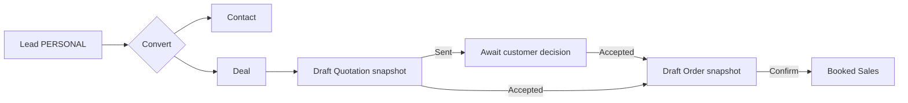

# WF-01 — Bán hàng cho khách cá nhân

[← Danh sách workflow](README.md) · [Feature 1](../features/crm/LEAD_CONVERSION.md) · [Feature 2](../features/sales/QUOTATION.md) · [Feature 3](../features/sales/ORDER.md)

- **Scenario/Actors:** Sales User tiếp nhận Lead cá nhân, convert, tạo Deal → Quotation → Accepted Order.
- **Preconditions/Input:** Lead readable/writable, Contact identity đủ, Product sellable, pricing readable. Output: linked Contact/Deal, snapshot Quotation/Order.
- **Modules/permissions:** M01/M02/M04–M07/M08; backend create/write ở từng bước.
- **Exceptions/result:** duplicate conversion, price missing, approval required, Quote chưa Accepted hoặc Order đã tồn tại phải trả lỗi/existing record. Kết quả mong đợi là một chuỗi truy vết không nhân đôi.
- **Contract:** [BF-02 conversion](../architecture/BUSINESS_FLOW_CONTRACT.md#bf-02--lead--contactcompanydeal), [BF-04 Quotation](../architecture/BUSINESS_FLOW_CONTRACT.md#bf-04--leaddeal--quotation), [BF-05 Order](../architecture/BUSINESS_FLOW_CONTRACT.md#bf-05--accepted-quotation--order).
- **Status:** Source implemented; role/browser acceptance trên baseline pending.

