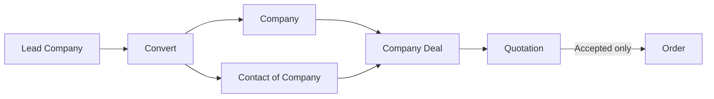

# WF-02 — Bán hàng cho khách doanh nghiệp

[← Danh sách workflow](README.md) · [Feature 1](../features/crm/CUSTOMER.md) · [Feature 2](../features/crm/DEAL_PIPELINE.md) · [Feature 3](../features/sales/ORDER.md)

- **Scenario/Actors:** Sales quản lý Lead Company, Company + Contact đại diện, Deal và chứng từ.
- **Preconditions/Input/Output:** Company identity và Contact hiện chỉ gắn một Company; Deal `COMPANY` phải có Company, Contact nếu có phải thuộc Company; output như WF-01.
- **Modules/permissions:** M01/M02/M05–M07; linked records phải readable.
- **Exceptions/result:** Contact–Company mismatch bị backend từ chối; quan hệ một Contact/nhiều Company chưa hỗ trợ. Kết quả là snapshot đúng Company.
- **Contract:** [BF-02 conversion](../architecture/BUSINESS_FLOW_CONTRACT.md#bf-02--lead--contactcompanydeal), [BF-04 Quotation](../architecture/BUSINESS_FLOW_CONTRACT.md#bf-04--leaddeal--quotation), [BF-05 Order](../architecture/BUSINESS_FLOW_CONTRACT.md#bf-05--accepted-quotation--order).
- **Status:** Source implemented với giới hạn `EXT-01`; acceptance pending.

