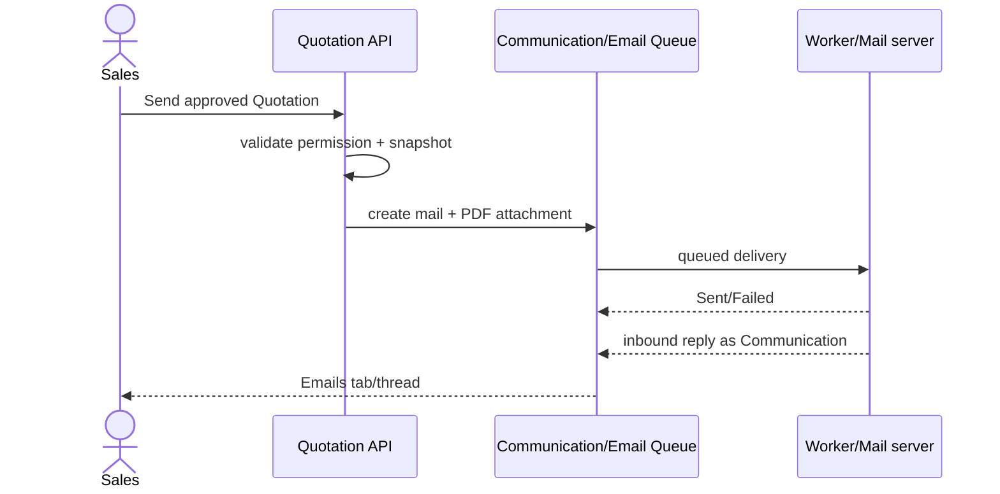

# WF-03 — Gửi/nhận Email và báo giá PDF

[← Danh sách workflow](README.md) · [Feature 1](../features/sales/QUOTATION.md) · [Feature 2](../features/contact-center/EMAIL.md)

- **Scenario/Actors:** Sales gửi PDF; mail worker/provider giao thư; inbound mail tạo Communication; Sales reply đúng thread.
- **Preconditions/Input/Output:** Quotation readable/writeable, approval hợp lệ, Email Account cấu hình; output private PDF/File, Communication, Email Queue.
- **Modules/permissions:** M06/M09/Frappe Email; read/write Quotation và attachment.
- **Exceptions/result:** missing recipient/account, queue/provider failure, duplicate click, inbound sai reference. Một click hợp lệ tạo đúng một delivery job/Communication theo contract.
- **History continuity:** Communication giữ exact Quotation/Deal/Lead reference; không merge email giữa hai Deal cùng customer. Xem [Customer history continuity](../architecture/BUSINESS_FLOW_CONTRACT.md#customer-history-continuity).
- **Status:** Source and historical test/live evidence exist; baseline live delivery/browser acceptance pending.

