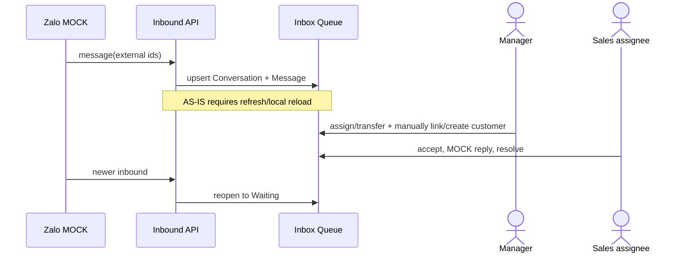

# WF-04 — Tiếp nhận và chăm sóc qua Zalo OA

[← Danh sách workflow](README.md) · [Feature 1](../features/contact-center/INBOX.md) · [Feature 2](../features/crm/IDENTITY_DUPLICATES.md)

- **Scenario/Actors:** authenticated MOCK inbound caller, Sales Manager/System Manager, assigned Sales User.
- **Preconditions/Input/Output:** synthetic OA/user/message IDs and timezone-aware timestamp; output deterministic Conversation/Message, workflow Event và optional manually created/linked Lead/Contact.
- **Modules/permissions:** M09/M02; Manager assign/transfer/link/create Lead, Sales chỉ thấy assigned thread và phải Accept trước reply; record read required.
- **Exceptions/result:** inbound replay cùng identity trả duplicate; cùng message ID nhưng khác sender/direction bị từ chối, còn content/timestamp đổi trên cùng identity chưa được so sánh. Workflow request ID với action payload khác bị từ chối; stale version bị từ chối; transfer/relink cần reason; inbound mới hơn `resolved_at` reopen Waiting. Shared Inbox/record history remains one source.
- **Realtime AS-IS/GAP:** inbound không tự xuất hiện; không có Zalo publish/subscription/poll. Target permission-safe event + refetch/merge được định nghĩa ở [BF-RT-01](../architecture/BUSINESS_FLOW_CONTRACT.md#bf-rt-01--inbound-chat--inboxthread-realtime).
- **Identity AS-IS/GAP:** inbound không tự tạo Lead; Create/Link do user thực hiện. Target automatic Lead có ambiguity guard ở [BF-01](../architecture/BUSINESS_FLOW_CONTRACT.md#bf-01--inbox--leadcontact-và-customer-record).
- **Status:** MOCK workflow source implemented; automated test exists nhưng không chạy trong task; realtime target và LIVE webhook/outbound chưa implemented/verified.

