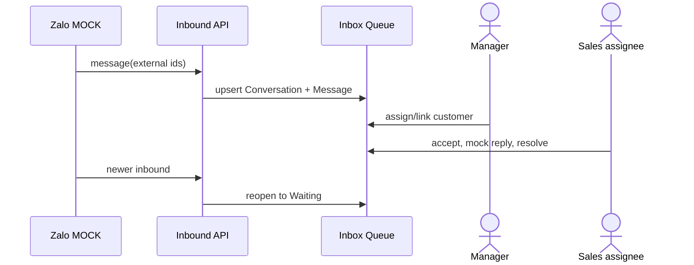

# WF-04 — Tiếp nhận và chăm sóc qua Zalo OA

[← Danh sách workflow](README.md) · [Feature 1](../features/contact-center/INBOX.md) · [Feature 2](../features/crm/IDENTITY_DUPLICATES.md)

- **Scenario/Actors:** authenticated mock caller, Manager, assigned Sales User.
- **Preconditions/Input/Output:** synthetic OA/user/message IDs and timestamp; output Conversation/Message/Event and optional Lead/Contact link.
- **Modules/permissions:** M09/M02; Manager assign/link, Sales only assigned thread; record read required.
- **Exceptions/result:** replay returns duplicate, reused ID with different identity fails, stale version fails, newer inbound reopens Resolved. Shared Inbox/record history remains one source.
- **Status:** MOCK source implemented; LIVE webhook/outbound not implemented or verified.

