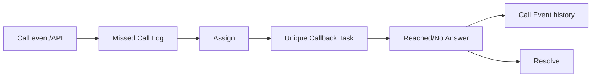

# WF-05 — Cuộc gọi nhỡ và Callback Task

[← Danh sách workflow](README.md) · [Feature 1](../features/contact-center/CALLS.md) · [Feature 2](../features/activities/TASKS.md)

- **Scenario/Actors:** Call Log API creates missed call; Manager assigns; Sales opens callback and records result.
- **Preconditions/Input/Output:** stable `external_call_id`, valid timestamps/agent; optional unique Lead/Contact phone match; output Call Log/Event and unique callback Task.
- **Modules/permissions:** M10/M08; Call role and assignee hooks.
- **Exceptions/result:** duplicate event/callback returns existing record; unassigned/unrelated user denied; ambiguous phone remains unlinked. Company/Deal are not allowed Call references AS-IS. Result preserves call/task link and audit.
- **Contract:** [BF-07](../architecture/BUSINESS_FLOW_CONTRACT.md#bf-07--missed-call--callback-task) and [Call customer-context boundary](../architecture/BUSINESS_FLOW_CONTRACT.md#call-customer-context-decision-boundary).
- **Status:** Source implemented; PBX live acceptance pending.

