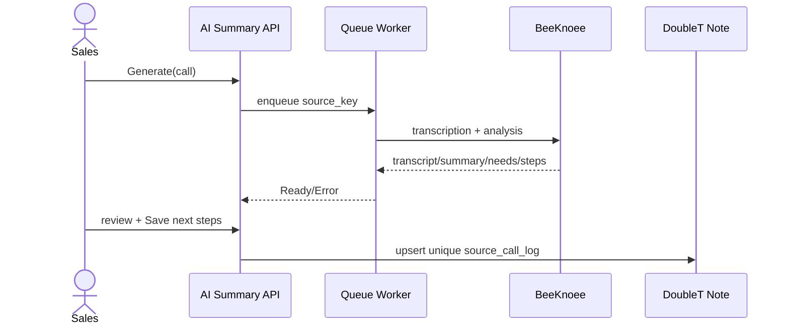

# WF-06 — Recording → AI Call Summary → Note

[← Danh sách workflow](README.md) · [Feature 1](../features/contact-center/CALLS.md) · [Feature 2](../features/activities/NOTES_TIMELINE.md)

- **Scenario/Actors:** authorized handler requests Generate/Regenerate, worker calls BeeKnoee, employee reviews next steps.
- **Preconditions/Input/Output:** one readable private recording ≤25 MB, protected provider config; output AI Summary and optional one Note.
- **Modules/permissions:** M10/M08; call scope, File access and Note create/write.
- **Exceptions/result:** missing/ambiguous recording, rate/budget limit, worker/provider error and relink require explicit states; never auto-publish unreviewed text.
- **Status:** DEMO path/source implemented; real provider and recording acceptance pending.

