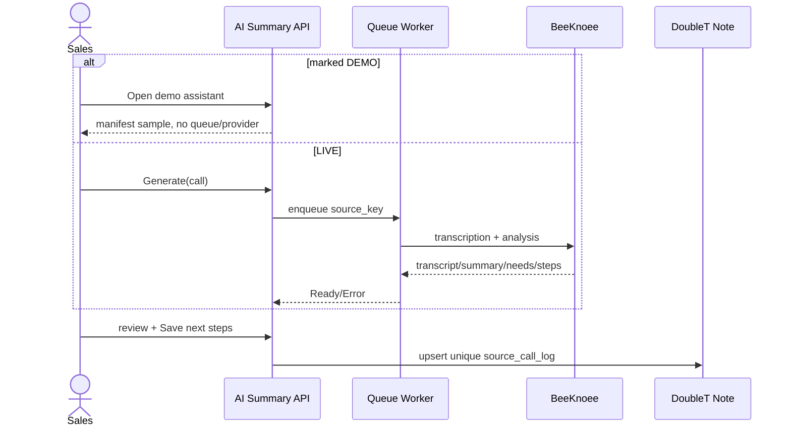

# WF-06 — Recording → AI Call Summary → Note

[← Danh sách workflow](README.md) · [Feature 1](../features/contact-center/CALLS.md) · [Feature 2](../features/activities/NOTES_TIMELINE.md)

- **Scenario/Actors:** authorized handler opens a marked DEMO or requests LIVE Generate/Regenerate; employee reviews next steps.
- **Preconditions/Input/Output:** DEMO requires matching private manifest/recording and never calls provider; LIVE requires one readable private recording ≤25 MB plus protected provider config. Output is displayed summary and at most one linked Note.
- **Modules/permissions:** M10/M08; call scope, File access and Note create/write.
- **Exceptions/result:** missing/ambiguous/stale recording, rate/budget limit, worker/provider error, handover/relink và stale Note version require explicit states; never auto-publish unreviewed text. `source_call_log` prevents duplicate Notes.
- **Contract:** [BF-08 AI Summary → reviewed Note](../architecture/BUSINESS_FLOW_CONTRACT.md#bf-08--ai-summary--reviewed-note). Note giữ original source/customer provenance; không tự chuyển sang Company/Deal khi Call được relink.
- **Status:** DEMO and LIVE source branches implemented; automated test exists but was not run here. Real provider/recording/browser acceptance pending.

