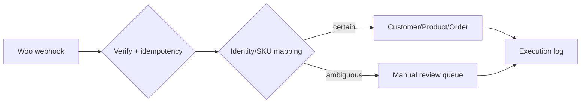

# WF-07 — Đồng bộ WooCommerce

[← Danh sách workflow](README.md) · [Feature 1](../features/integration/WOOCOMMERCE.md) · [Feature 2](../features/crm/CUSTOMER.md)

- **Scenario/Actors:** WooCommerce, integration principal, data manager.
- **Preconditions/Input/Output:** chưa có contract chốt chiều sync, credential, external IDs hay conflict policy; mục tiêu là Customer/Product/Order mapping.
- **Modules/permissions:** M12 → M02/M04/M07; least privilege and explicit identity decision.
- **Exceptions/result:** missing SKU, duplicate identity, out-of-order/repeated event, price ownership conflict phải vào log/queue xử lý.
- **Status:** Target architecture; không tìm thấy implementation trong baseline.

