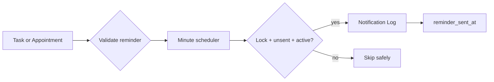

# WF-08 — Task/Appointment → Reminder → Notification

[← Danh sách workflow](README.md) · [Feature 1](../features/activities/APPOINTMENTS_REMINDERS.md) · [Feature 2](../features/activities/TASKS.md)

- **Scenario/Actors:** Sales schedules activity/reminder; minute scheduler delivers Notification Log to assignee.
- **Preconditions/Input/Output:** due/start time, enabled assignee, reminder not later than due/start; output one Notification Log and sent marker.
- **Modules/permissions:** M08 + Frappe scheduler; assignee/linked-record scope.
- **Exceptions/result:** terminal activity, changed time/assignee/status, invalid record or retry. Row lock/sent marker prevent duplicate.
- **Context contract:** Activity tạo từ hồ sơ giữ exact Dynamic Link theo [BF-06](../architecture/BUSINESS_FLOW_CONTRACT.md#bf-06--customer-record--tasknoteappointment); Notification không đổi source context.
- **Status:** Source implemented; migration/scheduler/live role acceptance pending.

