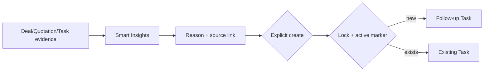

# WF-09 — Smart Insights → Follow-up Task

[← Danh sách workflow](README.md) · [Feature 1](../features/analytics/SMART_INSIGHTS.md) · [Feature 2](../features/automation/FOLLOW_UP.md)

- **Scenario/Actors:** authorized user reviews deterministic alert and explicitly creates Task.
- **Preconditions/Input/Output:** alert still valid/readable and Task assignee/reference valid; output one active follow-up Task.
- **Modules/permissions:** M11 → M08; report and source record access plus Task create.
- **Exceptions/result:** stale alert, unsupported Quotation reference, concurrent request or existing marker returns denial/existing task.
- **Status:** Explicit action source implemented; fully automatic `NEW-02` target not implemented.

