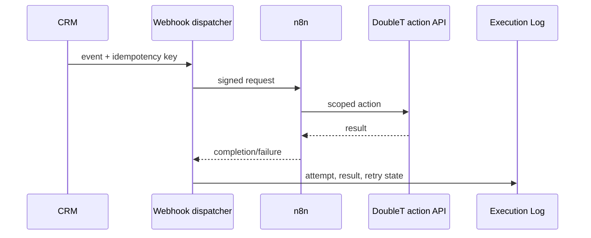

# WF-10 — CRM Event → Webhook → n8n → Action → Execution Log

[← Danh sách workflow](README.md) · [Feature 1](../features/integration/WEBHOOK_N8N.md) · [Feature 2](../features/automation/DEAL_AUTOMATION.md)

- **Scenario/Actors:** CRM publisher, signed webhook, n8n, target action API, administrator.
- **Preconditions/Input/Output:** event schema/version, endpoint secret, idempotency key and retry policy; output action result/execution log.
- **Modules/permissions:** M12 with target module; no broad integration Administrator token.
- **Exceptions/result:** timeout, signature fail, duplicate, action failure or feedback loop must be observable and replayable safely.
- **Status:** Target architecture; workflow exports/log platform not present in baseline.

