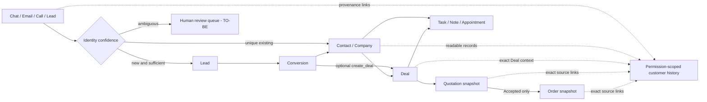

# WF-11 — Customer lifecycle xuyên kênh

[← Danh sách workflow](README.md) · [Business Flow Contract](../architecture/BUSINESS_FLOW_CONTRACT.md) · [Cross-module acceptance](../testing/CROSS_MODULE_ACCEPTANCE.md)

## Business scenario

Khách mới hoặc khách quay lại bắt đầu từ Chat/Email/Call/Lead, được định danh có kiểm soát, chuyển thành Contact/Company, phát sinh Deal → Quotation → Accepted Order và tiếp tục được chăm sóc bằng Activities. Customer history là projection có provenance, không phải bản sao hoạt động.

- **Actors:** Sales User, Sales Manager/System Manager, authenticated integration principal.
- **Preconditions:** source event hợp lệ; user có quyền nguồn/đích; identity không xung đột; Product/Pricing sẵn sàng khi bán hàng.
- **Input:** external identity/message/call/email hoặc Lead; customer type; source IDs.
- **Output:** một chuỗi record có link truy vết, snapshot thương mại và activity riêng đúng context.

## Checkpoints và ngoại lệ

1. **Identity:** duplicate external event không tạo Message/Lead mới; ambiguous match dừng để xác nhận.
2. **Conversion:** Personal/Company giữ converted links; Deal là tùy chọn lúc convert, có thể tạo sau; Contact đại diện không được gắn nhầm Company.
3. **Navigation:** context đã biết được prefill và lưu; reload phải giữ link.
4. **Sales:** `get_quotation_draft_context` kiểm source chain; chỉ Accepted Quotation tạo Order mới; nếu Order đã tồn tại, trả đúng Order có quyền đọc trước khi kiểm điều kiện tạo mới.
5. **History:** source route, source ID và permission được giữ; hai Deal cùng customer không trộn activity Deal-specific.
6. **Denied access:** list/event/route không làm lộ label, preview hoặc ID ngoài quyền.

## AS-IS / TO-BE / GAP

- **AS-IS:** manual Create/Link Lead/Contact cho Zalo MOCK; Lead conversion; record navigation; Deal/Lead → Quotation; Accepted Quotation → Order; Activities; report drill-down và Smart Insight follow-up.
- **TO-BE:** realtime chat; automatic Lead khi identity đủ chắc; ambiguous identity queue; Contact/Company → Deal prefill; unified customer-history view.
- **GAP:** durable external identity mapping, Company/participant rule cho Calls, cross-channel history completeness và runtime E2E evidence.
- **Acceptance status:** scenarios đã đặc tả tại [CROSS_MODULE_ACCEPTANCE](../testing/CROSS_MODULE_ACCEPTANCE.md); **NOT RUN** trong task documentation-only.
